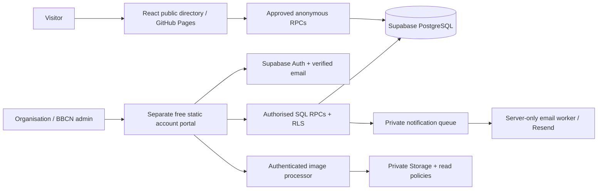

# BBFind architecture and delivery notes

The original Phase 1 proposal has progressed into implementation. The original supplied brief remains in PROJECT_BRIEF.md and image requirements in IMAGE_REQUIREMENTS.md. **The user's later instruction removes app audit/revision history.** Only current published content and one pending proposal are retained.

## Architecture

Frontend: React, TypeScript, Vite, React Router, modern CSS and self-hosted fonts. Original vector community illustrations are clearly demonstration content. Backend: Supabase PostgreSQL/Auth/Storage; image validation/re-encoding uses portable open-source PNG/JPEG codecs rather than paid image transformations. Public navigation never needs an account.

`src/api.ts` wraps backend access. `src/domain.ts` defines public content validation and search. `src/Accounts.tsx`, `Admin.tsx` and `Images.tsx` separate account, moderation and image management. SQL is in `supabase/migrations`; server-only functions are in `supabase/functions`. Future events can extend listing types and reuse organisation/image ownership without separate accounts. No events system is built.

Each organisation owns multiple listings. Programmes, services and venues own their own images. Pending listing text and pending image metadata never overwrite the approved version automatically. Images have individual decisions; replacements swap only on approval. No user-facing history is retained. Full current schema/security details are in DATABASE.md.

## Delivery phases

1. Inspection/design: completed for an originally empty repository; free-tier and hosting constraints documented.
2. Public directory: implemented with fictional examples unless connected to Supabase; search, category/suburb filters, venue filtering and shareable listing URLs.
3. Database/auth: migration, verified-email integration, private account handling and access policies implemented; hosted project/SMTP still requires BBCN configuration.
4. Organisation dashboard: multiple listing types, drafts/submissions, account management and per-listing image proposals implemented.
5. Administration: listing and individual-image review, feedback, suspension, publication controls, flags and taxonomy management implemented.
6. Validation/deployment: local tests, CI, manual Pages deployment, portal instructions and handover documentation included. Hosted SMTP, free-function performance, live deployments and restoration must be validated with BBCN-owned services before launch.

This is not a claim that all hosted capabilities are operational. README.md and DEPLOYMENT.md distinguish implementation from production configuration and validation. No paid dependencies are introduced and no services have been published from this workspace.
